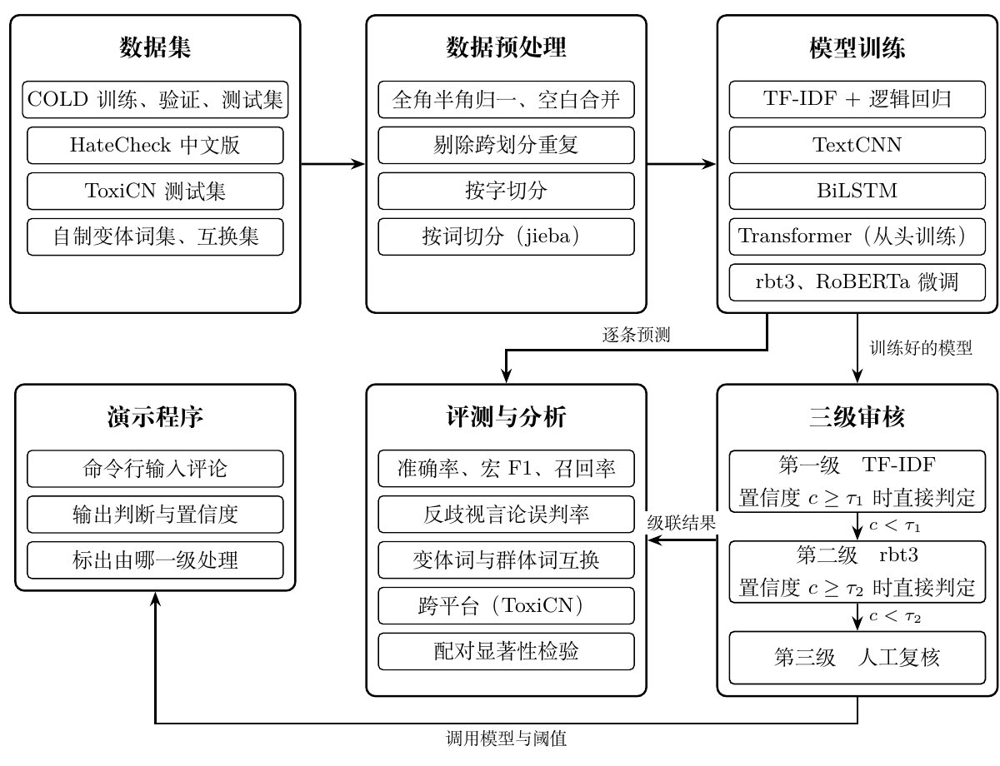
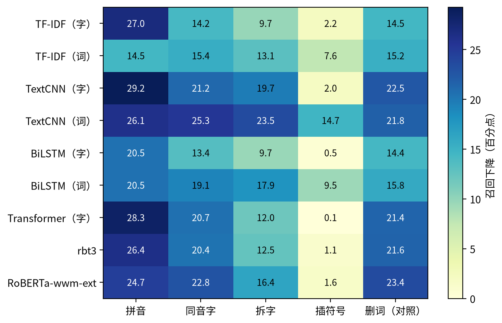
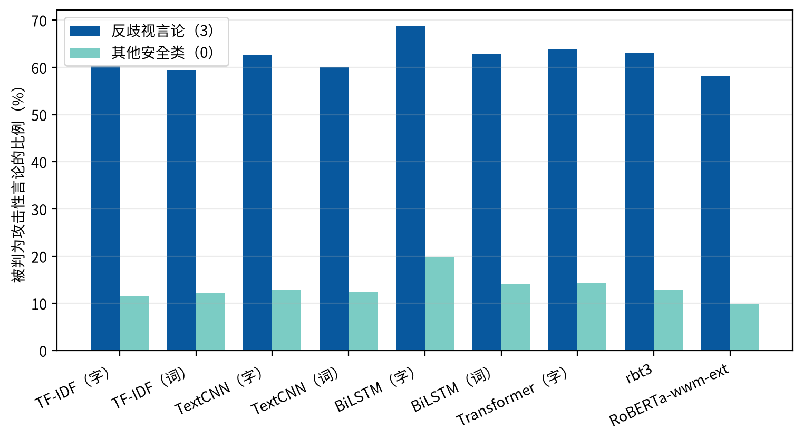
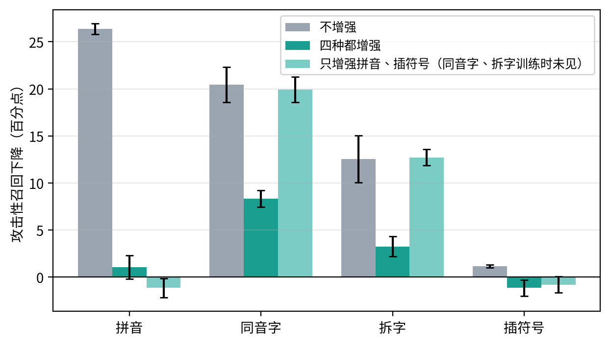
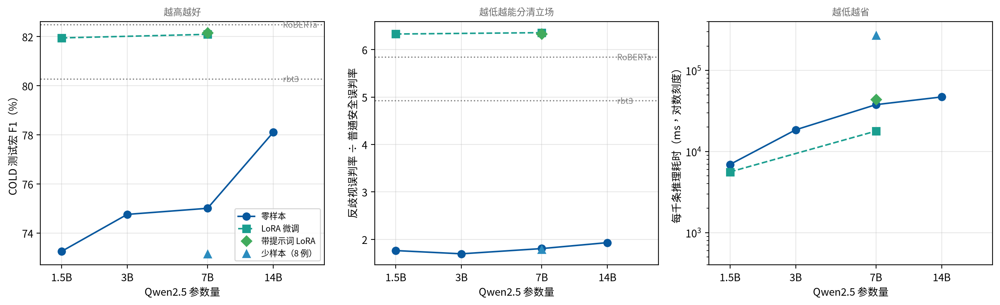
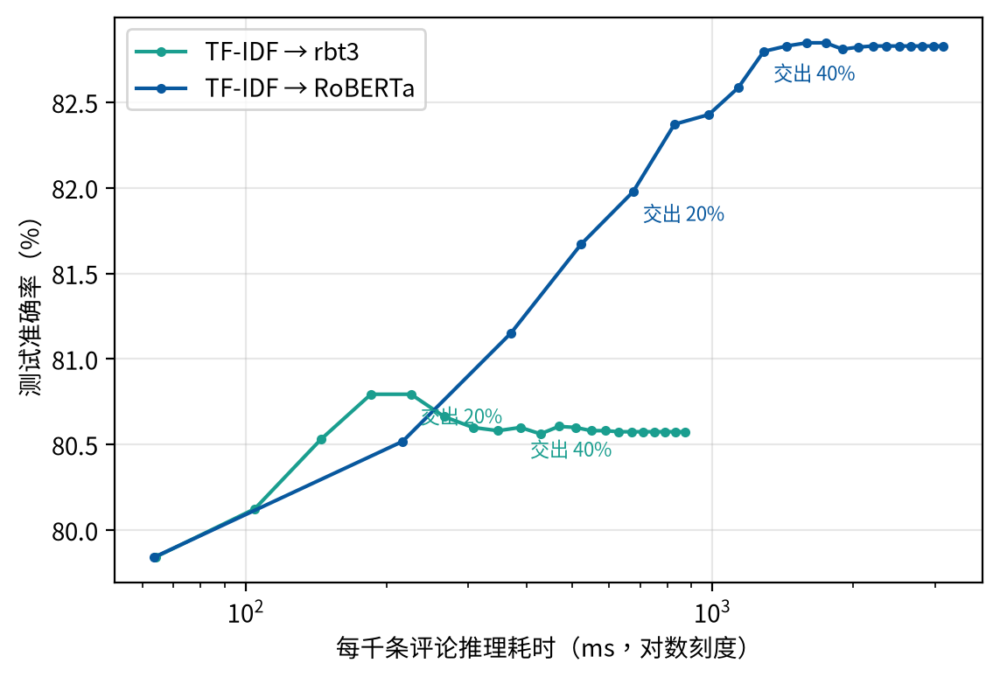
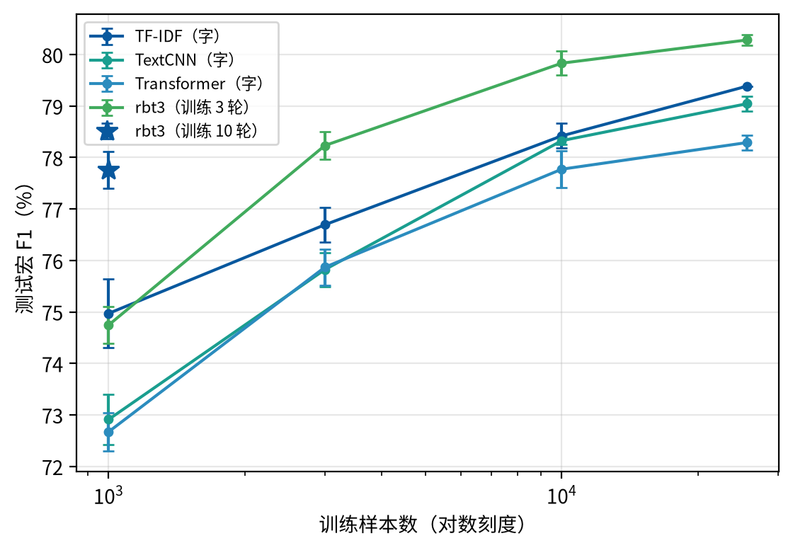
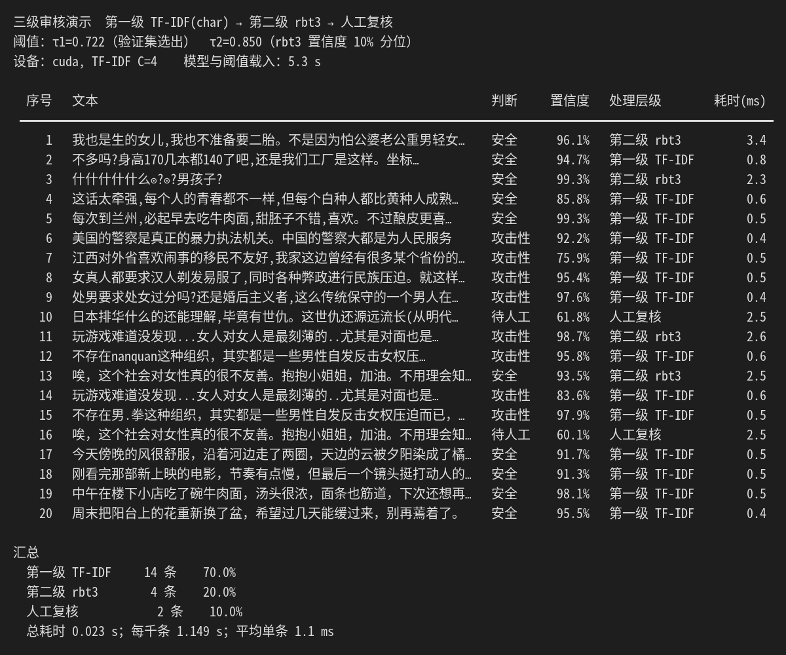

# 中文网络社交媒体攻击性言论识别

在 COLD 数据集上比较几类文本分类方法：字级、词级 TF-IDF 加逻辑回归，TextCNN，BiLSTM，从头训练的 Transformer，以及 rbt3、RoBERTa-wwm-ext 微调和 Qwen2.5 系列大模型。除了测试集上的准确率和宏 F1，还看三件事：

- 把敏感词改写成拼音、同音字、拆字或插入符号之后，模型还能不能认出来；
- 替被歧视群体说话的反歧视言论会不会被误判；
- 把评论里的地域、性别、种族群体词互换后，判断是否一致。

另外实现了一个三级审核流程：先用 TF-IDF 判断，没把握的交给预训练模型，仍没把握的留给人工复核。



## 主要结果

COLD 测试集上，RoBERTa-wwm-ext 的宏 F1 最高，为 82.5，只比字级 TF-IDF 高 3.1 个百分点，推理耗时却是后者的 48 倍。差距主要出在下面几处。

**变体词。** 把敏感词改写成拼音，各方法的召回下降 14 到 29 个百分点；插入符号只骗得过按词切分的方法。下图每格是改写前后攻击性召回之差，越深下降越多。



**反歧视言论。** 其他安全言论只有 10% 到 20% 被误判为攻击性，替群体辩护的反歧视言论却有 58% 到 69% 被误判，九种方法无一例外。



**变体词增强。** 把四种改写加进训练后，rbt3 在拼音变体上的召回下降从 26.4 个百分点降到 1.1；只加拼音和插符号时，训练中没见过的同音字几乎补不回来。



**大模型。** 不经训练的 Qwen2.5 对反歧视言论的误判倍数在 1.7 到 1.9 之间，微调过的模型都在 5 以上；用 LoRA 在 COLD 上微调 7B 后，宏 F1 升到 82.1，与 RoBERTa 相当，分清立场的能力也随之消失。



**三级审核。** 只把 40% 最没把握的评论交给 RoBERTa，准确率与全部交给它相当，推理耗时减少约 59%。



**训练量。** 训练样本从 1000 条加到全量 2.6 万条时各方法的宏 F1：



## 目录

```
src/        训练、评测、分析与作图代码
  data.py               数据载入、清洗、分词、跨划分去重
  baseline_tfidf.py     TF-IDF + 逻辑回归
  train.py              TextCNN / BiLSTM / Transformer（src/models/）
  finetune_bert.py      rbt3、RoBERTa-wwm-ext 微调
  make_cloak.py         生成变体词测试集
  make_swap.py          生成群体词互换测试集
  make_aug.py           生成变体词增强训练数据
  cascade.py            三级审核的阈值选择与级联预测
  bench_cascade.py      推理耗时测量
  attribution.py        积分梯度归因
  llm_zeroshot.py       Qwen2.5 零样本、少样本
  finetune_llm*.py      Qwen2.5 LoRA 微调
  llm_api.py            DeepSeek API 零样本（试点）
  llm_api_full.py       DeepSeek API 零样本（全量）
  significance.py       配对重抽样与 McNemar 检验
  analyze_*.py, judge_C.py, figs_*.py   汇总、判定与作图
  demo_moderate.py      三级审核的命令行演示
scripts/    各组实验的运行脚本
tests/      单元测试
results/    各次运行的结果汇总 JSON（不含逐条预测与评论原文）
demo/       演示用的示例评论与输出
```

## 环境

Python 3.13，主要依赖见 `requirements.txt`。实验在 NVIDIA V100S 32 GB 上运行。

```bash
pip install -r requirements.txt
```

## 数据

数据不随仓库分发，请从原处下载后放到 `data/external/`：

| 数据集 | 来源 | 许可 | 放置位置 |
|---|---|---|---|
| COLD | https://github.com/thu-coai/COLDataset | Apache-2.0 | `data/external/coldataset/raw/COLDataset/{train,dev,test}.csv` |
| HateCheck 中文版 | https://huggingface.co/datasets/Paul/hatecheck-mandarin | CC BY 4.0 | `data/external/huggingface-Paul_hatecheck-mandarin/raw/test.csv` |
| ToxiCN | https://github.com/DUT-lujunyu/ToxiCN | CC BY-NC-ND 4.0 | `data/external/toxicn/raw/ToxiCN_ex/ToxiCN/`（含 `data/` 与 `lexicon/`） |
| 拆字表 | https://github.com/kfcd/chaizi | CC BY 3.0 | `data/external/chaizi/raw/chaizi-jt.txt` |

变体词测试集和群体词互换测试集由脚本从 COLD 测试集生成，结果写到 `data_selfmade/`：

```bash
python src/make_cloak.py
python src/make_swap.py
python src/make_aug.py      # 只在做增强实验时需要
```

## 运行

单个模型：

```bash
python src/baseline_tfidf.py --dataset cold --tokenizer char
python src/train.py --dataset cold --model textcnn --tokenizer char --seed 0
python src/finetune_bert.py --dataset cold --model_path models/rbt3 --seed 0 --save_preds   # models/rbt3 为从 hfl/rbt3 下载的本地目录
```

整组实验用 `scripts/` 里的脚本，例如 `bash scripts/run_C.sh q1`，各脚本开头写了用法和可设的环境变量。大模型实验需要先下载 Qwen2.5-Instruct 权重，路径用环境变量 `QWEN7B` 等传入。DeepSeek API 实验从环境变量 `DEEPSEEK_API_KEY` 读密钥。

三级审核演示，需要先训练好 `checkpoints/cold_bert_demo_rbt3_s0`：

```bash
python src/demo_moderate.py --text "这条评论要审核"
python src/demo_moderate.py --csv demo/示例评论.csv
```



单元测试：

```bash
pytest tests
```

部分测试要读真实数据和本地的 rbt3 权重（`models/rbt3`），缺少时这些测试会失败，只检查代码逻辑的测试不受影响。

## 说明

- 训练集与验证集中和测试集重复的评论已删去，测试集保持完整，见 `data.py` 中的 `deduplicate_cold_splits`。
- 除 TF-IDF 外，每个设置跑 3 个种子，报均值与标准差。
- `demo/示例评论.csv` 中的评论摘自 COLD 测试集与由它生成的变体词测试集。

## 许可

代码采用 MIT 许可。数据集遵循各自的许可，ToxiCN 不允许商用和改编。
